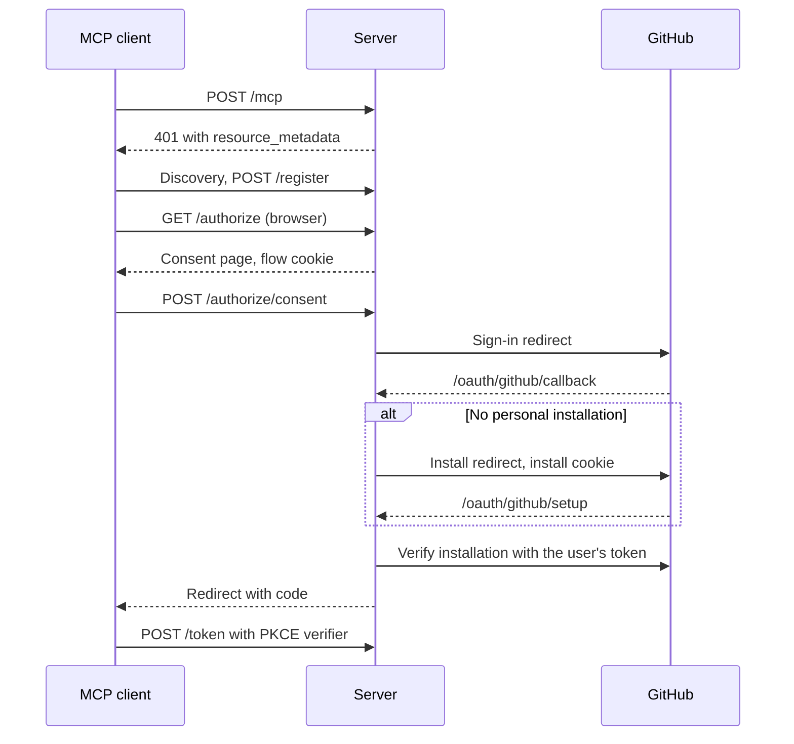

# Architecture Notes

## Module map
- `src/domain`: `Tenant`, `Todo`, files (`FilePath`, edits, line windows), tables (`domain/table/`: names, schema, typed values, filters, changes), `Expected` versions, and their invariants.
- `src/todos`: `TodoService` and the `TodoStore` port.
- `src/files`: `FileService` and the `FileStore` port.
- `src/tables`: `TableService` and the `TableStore` port.
- `src/oauth`: authorization server. `service.rs` owns every protocol decision, `routes.rs` and `bearer.rs` are transport, `seal.rs` is the only cryptography.
- `src/mcp`: tools and DTOs.
- `src/github`: `GitHubTodoStore`, `GitHubFileStore`, `GitHubTableStore`, `GitHubIdentity`, and `InstallationAccessProvider`.
- `src/app.rs`: wiring and the router.

## Key flows

Onboarding:

Tool call: `bearer::require_tenant` opens the token and puts the `Tenant` in the
request extensions. The tool reads it through `Extension<Parts>` and passes it to
`TodoService`, which passes it to `TodoStore`. `GitHubTodoStore::with_access`
resolves it to an installation token and the one repository. File tools take
the same path through `FileService`, `FileStore`, and
`GitHubFileStore::with_access`, with a token of their own scope. Table tools go
through `TableService`, `TableStore`, and `GitHubTableStore::with_access`, with
the same Contents scope as files.

## Boundary rules
- Sign-in comes before installation, because GitHub's install page does not
  return to the caller when the App is already installed.
- Sealed flow state crosses the install step in a cookie, not in `state`. That
  keeps GitHub tokens out of URLs, and GitHub does not document `state` being
  passed to the setup URL.
- Installation data is cached for 10 minutes per installation and token scope,
  which bounds how long a repository or installation change goes unnoticed.
  Failures are not cached, so a newly approved permission works at once.
- `file_edit` reads, applies the edits, and writes with the `sha` it read. On a
  conflict it repeats this once.
- Table row and schema changes work the same way: `TableService::change` reads
  the whole table, applies a `Change` (data, so it can be re-applied), and
  writes against the `sha` it read, retrying once. Queries read the whole table
  and filter in memory.

## Where mapping occurs
- Issue ↔ todo: `src/github/mapping.rs`.
- Repository contents ↔ files, including the `files/` root: `src/github/file_mapping.rs`.
- Repository contents ↔ tables, including the `tables/` root and the JSONL line format: `src/github/table_mapping.rs`.
- Tool arguments ↔ domain: `src/mcp/dto.rs`, `src/mcp/file_dto.rs`, `src/mcp/table_dto.rs`. Cell values cross as JSON and become `Raw`; the domain checks them against the schema.
