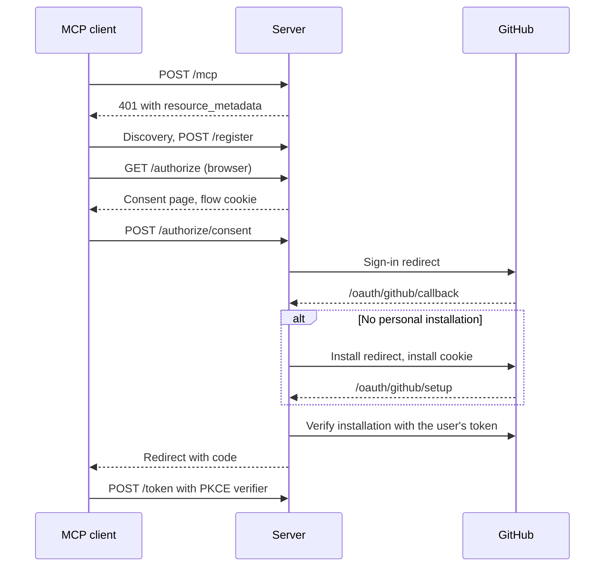

# Architecture Notes

## Module map
- `src/domain`: `Tenant`, `Todo`, and their invariants.
- `src/todos`: `TodoService` and the `TodoStore` port.
- `src/oauth`: authorization server. `service.rs` owns every protocol decision, `routes.rs` and `bearer.rs` are transport, `seal.rs` is the only cryptography.
- `src/mcp`: tools and DTOs.
- `src/github`: `GitHubTodoStore`, `GitHubIdentity`, and `InstallationAccessProvider`.
- `src/app.rs`: wiring and the router.

## Key flows

Onboarding:

Tool call: `bearer::require_tenant` opens the token and puts the `Tenant` in the
request extensions. The tool reads it through `Extension<Parts>` and passes it to
`TodoService`, which passes it to `TodoStore`. `GitHubTodoStore::with_access`
resolves it to an installation token and the one repository.

## Boundary rules
- Sign-in comes before installation, because GitHub's install page does not
  return to the caller when the App is already installed.
- Sealed flow state crosses the install step in a cookie, not in `state`. That
  keeps GitHub tokens out of URLs, and GitHub does not document `state` being
  passed to the setup URL.
- Installation data is cached for 10 minutes per installation, which bounds how
  long a repository or installation change goes unnoticed.

## Where mapping occurs
- Issue ↔ todo: `src/github/mapping.rs`.
- Tool arguments ↔ domain: `src/mcp/dto.rs`.
